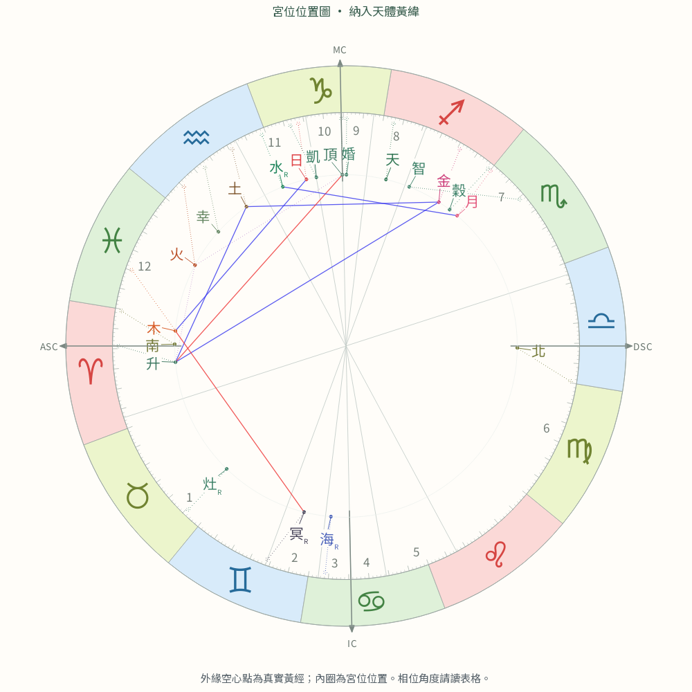
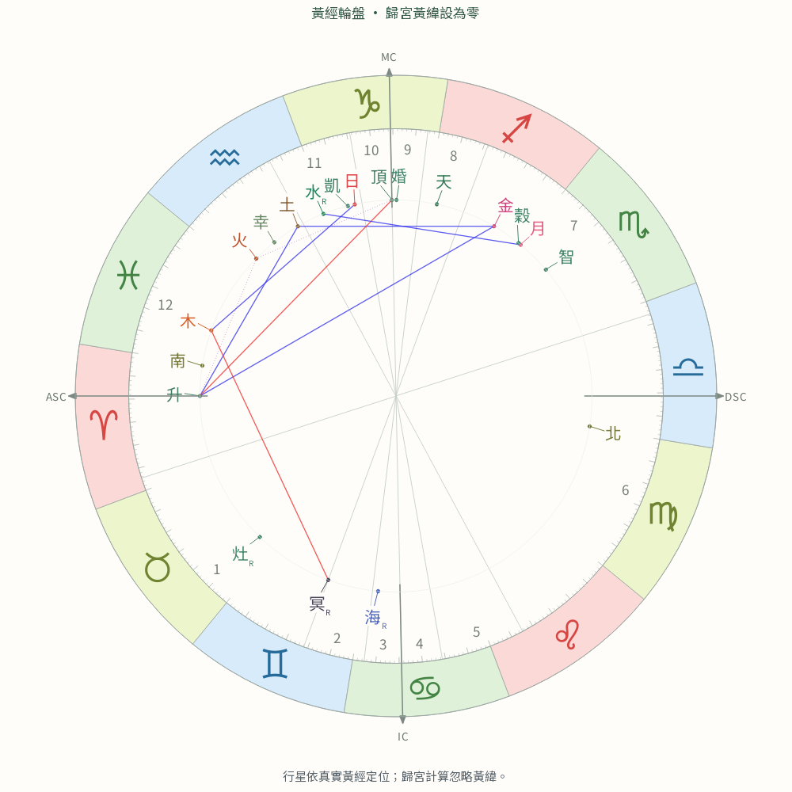
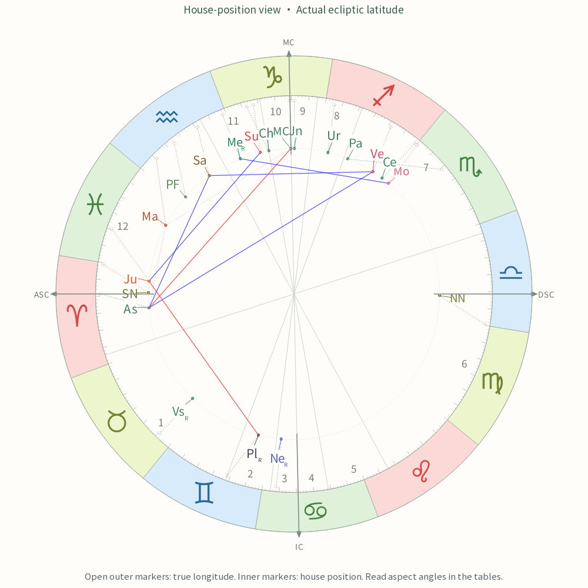
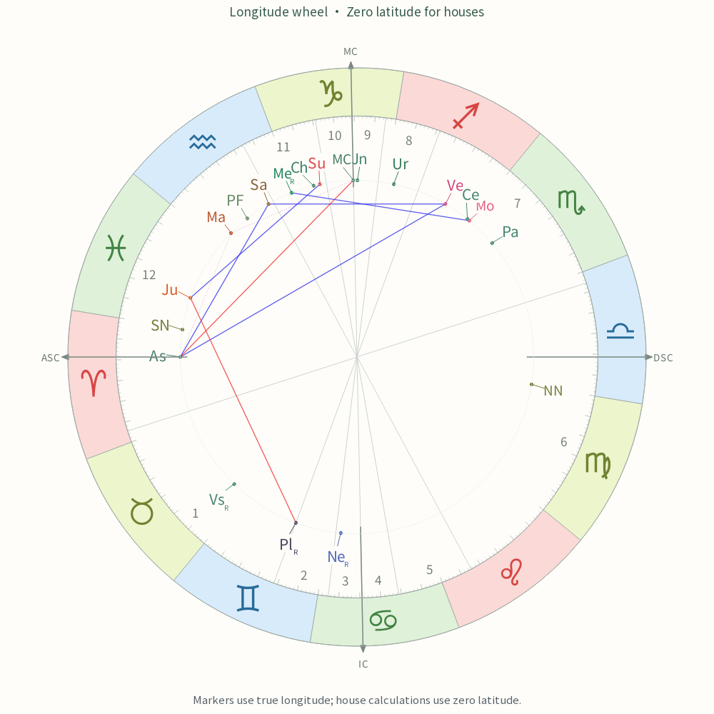

<!-- language:zh-TW -->
# Azimuth 修正後，為何 MC 一致，其他宮號仍與 Swiss 不同？

日期：2026-11-01。適用於 Open BirthChart v0.6.6（整合 v0.6.5 後續修正）；對照版本固定為 Swiss Ephemeris 2.10.03。本文補充[Azimuth 基本說明](azimuth.md)，不修改計算或既有基準。

**MC 差異歸零，表示它與第十宮頭的編號已對齊；不表示兩套程式對整個天空都使用相同的宮號對應。** 目前產品採用與自身十二宮頭一致的整圈編號，封存 Swiss 的一般點回傳仍可能採另一種方向／起點。因此天體座標非常接近，宮號卻可以不同。

## 先分開三件事

宮頭是各分宮面與黃道的交點；空間歸宮則詢問一個具有黃經與黃緯的點落在哪個方位區段；圖面是把選定座標畫到二維紙面。三者有關係，但不能互相替代。

例如非零黃緯天體的黃經落在兩個宮頭黃經之間，不保證其空間歸宮也在同一宮。另一方面，若零黃緯的第十宮頭本身被回傳為第四宮，就是編號對應需要核對，不能用黃緯投影來解釋。ASC 也不必等於 Azimuth 的第一宮頭，所以不能套用「ASC 永遠第一宮」的規則。

## 原先的 MC 第四／十宮矛盾

本地 LibEphemeris 的宮頭與一般 `house_pos` 路徑，在部分條件下未對齊起點與方向。將同一套算出的宮頭放回歸宮函式，就能看見差異。產品補丁由十二宮頭的空間方向建立對應，再把**每個點**的原始連續宮位座標換到同一套編號，不只把 MC 硬改為 10。

換算寫成：

```text
α = (原始宮位座標 − 1) × 30°
有效宮位座標 = 1 + [s × (α − α₁) mod 360°] / 30°
```

`α₁` 是第一宮起點，`s` 是編號方向，由十二宮頭的獨立幾何檢查決定。這裡的方向是空間方位座標的編號方向，不等同於黃經宮頭看起來正轉或反轉。原始座標先換算，最後才取整數宮號。天體黃經／黃緯、十二宮頭及原始 API 值不被改寫。

| 固定案例／城市 | 黃經宮頭排列 | α₁ | s | 為何不能只看 MC 或半球 |
|---|---|---:|---:|---|
| complete-1904-01-H／Melbourne | 正向 | 0° | −1 | MC 原始約 4，對齊為 10 |
| complete-1904-02-H／Bangkok | 正向 | 0° | +1 | 不需換編號，正常對照 |
| complete-1904-03-H／Darwin | 反向 | 180° | −1 | MC 原本就是 10，其他 19 點仍需對齊 |
| complete-1936-09-H／Manila | 反向 | 180° | +1 | 北半球也會需要改起點 |

四例完整輸入、兩引擎、兩模式與十二宮頭的原值另存[具名案例資料](../results/numerical/polich-unique-20261101/article-cases.json)及[對照表](../results/numerical/polich-unique-20261101/article-tables.md)。

## Melbourne：從十二宮頭到一般點

`complete-1904-01-H`：1904-01-13 11:41:25，`Australia/Melbourne`；南緯 37.814°、東經 144.96332°。下表是黃經度數，由 0° 牡羊起算；僅顯示值取九位小數，原始全精度另存。兩種歸宮黃緯模式使用同一組宮頭。

| 宮頭 | 產品黃經 | Swiss 黃經 |
|---|---:|---:|
| 1 | 27.178390588 | 27.178390525 |
| 2 | 79.145915476 | 79.145915473 |
| 3 | 92.466318163 | 92.466318126 |
| 4 | 100.520867445 | 100.520867380 |
| 5 | 109.309447765 | 109.309447669 |
| 6 | 127.592331742 | 127.592331583 |
| 7 | 207.178390588 | 207.178390525 |
| 8 | 259.145915476 | 259.145915473 |
| 9 | 272.466318163 | 272.466318126 |
| 10 | 280.520867445 | 280.520867380 |
| 11 | 289.309447765 | 289.309447669 |
| 12 | 307.592331742 | 307.592331583 |

以下都是連續宮位座標；括號才是最終整數宮號。每個引擎各自計算天體及宮頭，星盤比較使用固定的相同 TT／UT1，並非把產品的天體座標送入 Swiss。

| 黃緯模式／點 | Lib 原始值 | 產品有效值（宮號） | Swiss 原始值（宮號） |
|---|---:|---:|---:|
| 實際／MC | 4.000000000 | 10.000000000（10） | 10.000000000（10） |
| 實際／ASC | 1.156091950 | 12.843908050（12） | 1.156091958（1） |
| 實際／太陽 | 2.816149361 | 11.183850639（11） | 2.816149351（2） |
| 實際／月亮 | 6.390288567 | 7.609711433（7） | 6.390288561（6） |
| 實際／冥王星 | 11.547478073 | 2.452521927（2） | 11.547478089（11） |
| 零／MC | 4.000000000 | 10.000000000（10） | 10.000000000（10） |
| 零／ASC | 1.156091950 | 12.843908050（12） | 1.156091958（1） |
| 零／太陽 | 2.816139699 | 11.183860301（11） | 2.816139696（2） |
| 零／月亮 | 6.584767048 | 7.415232952（7） | 6.584767041（6） |
| 零／冥王星 | 12.001201245 | 1.998798755（1） | 12.001201256（12） |

MC 恰為第十宮頭；產品整圈換算後為 10，Swiss 此點也為 10。ASC 在本宮制不等於第一宮頭，產品因此可為 12。一般點的 Lib 與 Swiss 原始數值很接近，但產品換到宮頭編號後會不同；差異不是星體位置突然偏了幾個星座。

冥王星在實際模式為第 2 宮，零模式為第 1 宮，這才是**黃緯選擇造成的差異**；同模式下產品對 Swiss 的 2／11 或 1／12，則主要是**編號對應差異**。不能把兩種差異混稱為「黃緯問題」。

## 利馬案例也顯示同樣區別

固定主案例 `main-1947-04` 是 1947-04-06 **09:46:45**，`America/Lima`，南緯 12.04318°、西經 77.02824°，不是另一次手動對照的 09:47:00／度分座標。

| 點／模式 | 產品有效值（宮號） | Swiss 原始值（宮號） |
|---|---:|---:|
| MC／兩模式 | 10.000000000（10） | 10.000000000（10） |
| ASC／兩模式 | 12.273669156（12） | 1.726330852（1） |
| 水星／實際黃緯 | 12.137919327（12） | 1.862080677（1） |
| 水星／零黃緯 | 11.846380438（11） | 2.153619569（2） |

同一顆水星的黃緯選擇可以跨宮，但兩模式都仍需要同一套起點／方向對齊。不能藉關掉黃緯讓編號矛盾消失。

## 圖面與匯出如何對照？

開啟「歸宮納入天體黃緯」時，內圈依連續宮位位置放在相應宮頭扇區，外緣空心點保留真實黃經；它是宮位位置示意，不是等角天球投影。關閉時，圖面改畫黃經輪盤，但仍保留同一套 Azimuth 編號。相位數值仍按真實黃經計算。

以下為已驗收的 Melbourne 雙模式圖面，可與上表的月亮、冥王星對照；既有圖與文件原樣保留，這次只新增解釋文章。





[實際模式 HTML](../results/numerical/latitude-mode-20261031/exports/complete-1904-01-H-on-zh-TW.html)／[零模式 HTML](../results/numerical/latitude-mode-20261031/exports/complete-1904-01-H-off-zh-TW.html)含同份計算的宮頭、天體及相位表；也有相同檔名的 PDF。實際模式中，表格的真實星座位置不必和內圈示意位置相同。

## Swiss 的觀察與驗證範圍

本地 Swiss 2.10.03 公開行為對照顯示：極接近宮頭的點可以直接得到該宮頭編號，離開後卻回到另一套一般點座標。這解釋了為何 MC 對照相同仍不足以驗證鄰域或全部天體；這裡不從回傳行為推論未檢視的內部實作。[原診斷](../results/numerical/azimuth-root-cause-20261030/REPORT.md)／[補丁與鄰域驗證](../results/numerical/azimuth-patch-20261031/REPORT.md)

| 現行封存套件 | 每種黃緯模式下的 H 差異盤數 | 差異點數，含 ASC | MC 差異 |
|---|---:|---:|---:|
| complete-v2，2016 條件 | 78 | 1482 | 0 |
| main-v2，1200 條件 | 42 | 798 | 0 |
| boundary-v2，87 條件 | 16 | 304 | 0 |

這是各套件分別的統計，不能相加當作去重後樣本。87 條件包含 helper 與預期錯誤，共同可比星盤是 47 張；不是 87 張成功星盤。完全套件可比 H 宮頭最大黃經差約 0.002620 角秒，舊主／邊界合併 H 最大約 0.006110 角秒。這些小角差與上表的整數宮號差異分別記錄，`<30 角秒` 不能用來豁免跨宮。

資料入口：[完全](../regression/complete-v2/README.md)、[主案例](../regression/main-v2/README.md)、[邊界](../regression/boundary-v2/README.md)。本次 T 修改不改 H 計算；其精確保留情況見[本輪影響報告](../results/numerical/polich-unique-20261101/REPORT.md)。

這是產品為保持宮頭與整圈歸宮一致而採取的規則，不是上游官方修復，也不是宣稱所有 Swiss 差異都是錯誤。只在明列版本、固定案例、黃緯模式與幾何條件下作結論；既有基準、Swiss 原值及舊交付包均不改寫。

<!-- language:en-US -->
# After the Azimuth correction, why does MC agree with Swiss while other houses differ?

Date: 2026-11-01. Applies to Open BirthChart v0.6.6, incorporating the changes after v0.6.5, compared with Swiss Ephemeris 2.10.03. This supplements the [Azimuth introduction](azimuth.md) and changes neither calculations nor baselines.

**Agreement at the MC establishes its alignment with cusp 10; it does not establish identical numbering throughout the sky.** The product aligns the whole spatial coordinate with its twelve numbered cusps. Archived Swiss returns for ordinary points can retain a different origin or direction, producing different houses despite very similar celestial coordinates.

## Separate cusps, spatial placement and the drawing

Cusps are intersections of house planes with the ecliptic. Spatial placement assigns a point with longitude and latitude to an azimuth sector. A wheel presents selected coordinates on a flat page. These are related but distinct operations.

A nonzero-latitude body need not share the spatial house suggested by its longitude between two cusps. In contrast, assigning a zero-latitude tenth cusp to house 4 calls for a numbering check; latitude projection cannot explain that contradiction. The ASC also need not coincide with the first Azimuth cusp, so an unconditional ASC=1 rule is inappropriate.

## The original MC house 4/10 contradiction

The local LibEphemeris cusp and general `house_pos` paths do not align their origin and direction in every configuration. Feeding calculated cusps back into placement reproduces the mismatch. The application establishes a mapping from all twelve cusp directions and transforms **every point**, rather than only overriding MC:

```text
α = (raw house coordinate − 1) × 30°
effective coordinate = 1 + [s × (α − α₁) mod 360°] / 30°
```

The first-cusp origin `α₁` and numbering direction `s` come from independent geometry. This spatial-coordinate direction is distinct from whether cusp longitudes advance or reverse. Integer houses are taken after transformation. Celestial coordinates, cusps and raw API returns are preserved.

| Fixed case / city | Longitude cusp order | α₁ | s | Diagnostic significance |
|---|---|---:|---:|---|
| complete-1904-01-H / Melbourne | Forward | 0° | −1 | Raw MC near 4 becomes 10 |
| complete-1904-02-H / Bangkok | Forward | 0° | +1 | Identity mapping; normal control |
| complete-1904-03-H / Darwin | Reversed | 180° | −1 | MC already 10; other 19 points still need alignment |
| complete-1936-09-H / Manila | Reversed | 180° | +1 | A northern location also needs an origin change |

The [unrounded case data](../results/numerical/polich-unique-20261101/article-cases.json) and [tables](../results/numerical/polich-unique-20261101/article-tables.md) retain full inputs, twelve cusps and both engines in both modes.

## Melbourne: from twelve cusps to ordinary points

`complete-1904-01-H`: 1904-01-13 11:41:25, `Australia/Melbourne`, latitude −37.814°, longitude +144.96332°. Longitudes below are degrees from 0° Aries, displayed to nine decimals. Both placement-latitude modes use the same cusps.

| Cusp | Product longitude | Swiss longitude |
|---|---:|---:|
| 1 | 27.178390588 | 27.178390525 |
| 2 | 79.145915476 | 79.145915473 |
| 3 | 92.466318163 | 92.466318126 |
| 4 | 100.520867445 | 100.520867380 |
| 5 | 109.309447765 | 109.309447669 |
| 6 | 127.592331742 | 127.592331583 |
| 7 | 207.178390588 | 207.178390525 |
| 8 | 259.145915476 | 259.145915473 |
| 9 | 272.466318163 | 272.466318126 |
| 10 | 280.520867445 | 280.520867380 |
| 11 | 289.309447765 | 289.309447669 |
| 12 | 307.592331742 | 307.592331583 |

The following values are continuous house coordinates; parentheses show integer houses. Each engine calculates its own bodies and cusps at shared fixed TT/UT1. Product body coordinates were not supplied to Swiss.

| Mode / point | Raw Lib value | Product effective value (house) | Raw Swiss value (house) |
|---|---:|---:|---:|
| Actual / MC | 4.000000000 | 10.000000000 (10) | 10.000000000 (10) |
| Actual / ASC | 1.156091950 | 12.843908050 (12) | 1.156091958 (1) |
| Actual / Sun | 2.816149361 | 11.183850639 (11) | 2.816149351 (2) |
| Actual / Moon | 6.390288567 | 7.609711433 (7) | 6.390288561 (6) |
| Actual / Pluto | 11.547478073 | 2.452521927 (2) | 11.547478089 (11) |
| Zero / MC | 4.000000000 | 10.000000000 (10) | 10.000000000 (10) |
| Zero / ASC | 1.156091950 | 12.843908050 (12) | 1.156091958 (1) |
| Zero / Sun | 2.816139699 | 11.183860301 (11) | 2.816139696 (2) |
| Zero / Moon | 6.584767048 | 7.415232952 (7) | 6.584767041 (6) |
| Zero / Pluto | 12.001201245 | 1.998798755 (1) | 12.001201256 (12) |

The MC lies on cusp 10 and both final results give 10. The ASC is not cusp 1 in this system; the product gives 12. Ordinary raw Lib and Swiss values are very close, yet the product's numbering transform changes their house coordinates. The bodies have not shifted through several zodiac signs.

Pluto changes from product house 2 with actual latitude to house 1 with zero latitude: that is a **latitude-mode effect**. Product/Swiss pairs 2/11 and 1/12 within each mode primarily reflect **numbering alignment**. These effects must be distinguished.

## The Lima example

`main-1947-04` uses 1947-04-06 **09:46:45**, `America/Lima`, latitude −12.04318°, longitude −77.02824°. It is distinct from the separately investigated 09:47:00 example with degree/minute coordinates.

| Point / mode | Product effective value (house) | Raw Swiss value (house) |
|---|---:|---:|
| MC / both | 10.000000000 (10) | 10.000000000 (10) |
| ASC / both | 12.273669156 (12) | 1.726330852 (1) |
| Mercury / actual | 12.137919327 (12) | 1.862080677 (1) |
| Mercury / zero | 11.846380438 (11) | 2.153619569 (2) |

Changing Mercury's placement latitude can cross a house boundary, but both modes still require the same origin/direction mapping. Turning latitude off does not eliminate a numbering contradiction.

## Reading the wheel and exports

With “Use ecliptic latitude for houses” enabled, inner markers show continuous house position within the corresponding cusp sector; open outer markers retain true longitude. This is a house-position diagram, not an angle-preserving sky projection. With the option off, the wheel displays longitude while retaining the same Azimuth numbering. Aspect values continue to use true longitudes.

These previously validated Melbourne images illustrate the Moon and Pluto entries above. The existing artifacts are preserved; this change adds explanatory text only.





The [actual-mode HTML](../results/numerical/latitude-mode-20261031/exports/complete-1904-01-H-on-en-US.html) and [zero-mode HTML](../results/numerical/latitude-mode-20261031/exports/complete-1904-01-H-off-en-US.html) include cusp, body and aspect tables from the same calculations. PDFs have the same filenames. In actual mode, true zodiac positions in the table need not match inner schematic marker positions.

## Swiss observations and validation limits

Local Swiss 2.10.03 public behavior shows that a point extremely close to a cusp can return its numbered cusp directly, while a more distant point returns a different general coordinate. MC agreement alone therefore cannot validate the neighborhood or all bodies. This observation does not infer uninspected implementation details. [Original diagnosis](../results/numerical/azimuth-root-cause-20261030/REPORT.md) / [patch and neighborhood tests](../results/numerical/azimuth-patch-20261031/REPORT.md)

| Archived suite | H charts with differences, per latitude mode | Differing points, including ASC | MC differences |
|---|---:|---:|---:|
| complete-v2, 2016 conditions | 78 | 1482 | 0 |
| main-v2, 1200 conditions | 42 | 798 | 0 |
| boundary-v2, 87 conditions | 16 | 304 | 0 |

These are separate suites, not a deduplicated combined count. The 87 conditions include helpers and expected errors; only 47 charts are mutually comparable. Maximum H cusp-longitude differences were approximately 0.002620 arcsecond in the complete suite and 0.006110 arcsecond in the older combined main/boundary comparison. Small angular differences and integer-house disagreements are reported separately: a `<30 arcsecond` check cannot excuse a different house.

Archives: [complete](../regression/complete-v2/README.md), [main](../regression/main-v2/README.md), [boundary](../regression/boundary-v2/README.md). The current T change leaves H calculations intact; see its [impact report](../results/numerical/polich-unique-20261101/REPORT.md).

This is the product's rule for consistent cusp and whole-circle numbering, not an official upstream fix or a claim that every Swiss disagreement is an error. Conclusions are limited to the stated versions, cases, modes and geometry. Original baselines, Swiss returns and delivered packages remain unchanged.
